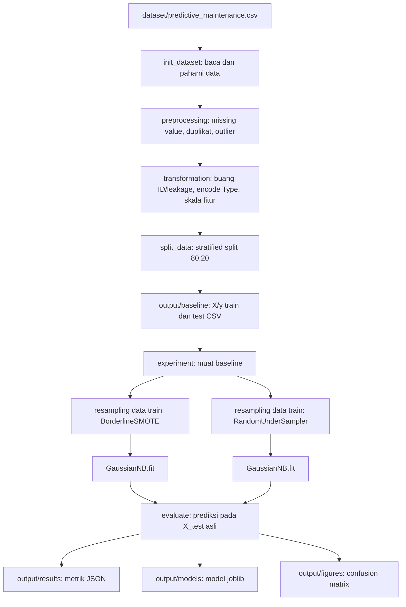

# Klasifikasi Predictive Maintenance — Naive Bayes

Proyek ini menjalankan pipeline klasifikasi kegagalan mesin pada dataset Predictive Maintenance. Pipeline mencakup pemahaman data, preprocessing, transformasi fitur, pembagian data, resampling pada data latih, pelatihan Gaussian Naive Bayes, dan evaluasi. Keluaran eksperimen tersimpan di folder `output/`.

Label target adalah `Target`: `0` = normal dan `1` = gagal. Kelas positif dalam perhitungan metrik adalah kelas `1` (gagal). Dataset yang disertakan memiliki 10.000 baris.

## Struktur proyek saat ini

```text
Tugas_Cindy/
├── README.md
├── main.py
├── dataset/
│   └── predictive_maintenance.csv
├── src/
│   ├── config.py
│   ├── evaluate.py
│   ├── experiment.py
│   ├── init_dataset.py
│   ├── naive_bayes.py
│   ├── preprocessing.py
│   ├── resampling.py
│   ├── split_data.py
│   ├── transformation.py
│   └── utils.py
├── tests/
│   └── uji_naive_bayes.py
└── output/
    ├── baseline/
    │   ├── X_test.csv
    │   ├── X_train.csv
    │   ├── y_test.csv
    │   └── y_train.csv
    ├── figures/
    │   ├── 01_distribusi_awal.png
    │   ├── 02_boxplot_sebelum.png
    │   ├── 03_boxplot_sesudah.png
    │   ├── 04_distribusi_split.png
    │   ├── cm_nb_over.png
    │   └── cm_nb_under.png
    ├── models/
    │   ├── nb_over.joblib
    │   └── nb_under.joblib
    └── results/
        ├── nb_over.json
        └── nb_under.json
```

`requirements.txt`, `src/__init__.py`, dan skrip pembuat ZIP tidak ada pada isi workspace yang ditinjau. Karena itu, petunjuk instalasi di bawah mencantumkan dependensi secara langsung dan struktur di atas hanya memuat file yang tersedia.

## Arsitektur

`main.py` mengoordinasikan tahap pipeline. Modul tahap berada terpisah di `src/`, sedangkan konstanta path dan parameter terpusat di `src/config.py`. Dataset dibaca dari `dataset/`; hasil antara split disimpan sebagai baseline agar eksperimen dapat dijalankan ulang tanpa menjalankan ulang preprocessing. Modul eksperimen menggunakan dua fungsi resampling untuk data latih saja, lalu menyerahkan model terlatih dan data uji asli ke modul evaluasi.



### Urutan dan tanggung jawab modul

| Modul | Peran |
|---|---|
| `main.py` | Menjalankan tahap secara berurutan dan menyediakan opsi `--stage`. |
| `src/config.py` | Menentukan lokasi dataset/output, target dan kolom, parameter split, parameter resampling, serta konstanta eksperimen. Sebagian konstanta SVM/Decision Tree tetap ada untuk kompatibilitas proyek kelompok, tetapi bukan bagian eksperimen Naive Bayes ini. |
| `src/init_dataset.py` | Membaca CSV, menampilkan ringkasan data/distribusi, menyimpan grafik distribusi target awal. |
| `src/preprocessing.py` | Menangani missing value (numerik dengan median, kategorikal dengan modus), mendeteksi dan menangani duplikat, menghitung batas IQR, melakukan clipping, dan menyimpan boxplot. |
| `src/transformation.py` | Menghapus kolom ID serta `Failure Type`, mengubah `Type` (`L/M/H`) menjadi angka, memisahkan fitur dan target, lalu melakukan MinMax scaling. |
| `src/split_data.py` | Membagi data secara stratified menjadi train/test dengan `test_size=0.2` dan `random_state=42`; menyimpan dan memuat empat file baseline. |
| `src/resampling.py` | Menyediakan BorderlineSMOTE dengan `sampling_strategy=0.5` dan RandomUnderSampler dengan `sampling_strategy=1.0`; kedua metode memakai seed `42`. Resampling hanya digunakan pada data latih. |
| `src/experiment.py` | Memuat baseline; untuk setiap skenario melakukan resampling data latih, membuat model dari factory, melatih, lalu mengevaluasi pada test asli. |
| `src/naive_bayes.py` | Memilih `GaussianNB` dan menjalankan eksperimen `nb_over` serta `nb_under`. |
| `src/evaluate.py` | Menghitung accuracy, precision, recall, F1, dan TN/FP/FN/TP; menyimpan metrik JSON, model joblib, dan confusion matrix. |
| `src/utils.py` | Fungsi tampilan, penyimpanan grafik, dan helper untuk menahan output tahap sebelumnya saat menjalankan satu stage. |
| `tests/uji_naive_bayes.py` | Skrip verifikasi integrasi untuk baseline, resampling, artefak, metrik, dan model tersimpan. Skrip ini bukan kumpulan fungsi `pytest` dengan pola nama `test_*.py`. |

## Alur data dan parameter

1. `init_dataset` membaca dataset dan membuat grafik distribusi target.
2. `preprocessing` memeriksa missing value dan duplikat, lalu melakukan clipping outlier menggunakan batas IQR (`1.5 × IQR`).
3. `transformation` membuang `UDI`, `Product ID`, dan `Failure Type`; mengodekan `Type`; memisahkan `X` dan `y`; serta menerapkan `MinMaxScaler`.
4. `split_data` membagi data secara stratified, 80% train dan 20% test, dengan seed `42`. Baseline berisi `X_train.csv`, `X_test.csv`, `y_train.csv`, dan `y_test.csv`.
5. `experiment` menjalankan dua percobaan independen. Resampling hanya mengubah data training; `X_test` dan `y_test` asli dipakai untuk evaluasi keduanya.
6. `evaluate` menyimpan laporan numerik, model, dan confusion matrix untuk setiap percobaan.

`--stage <tahap>` menampilkan tahap yang dipilih. Tahap sebelumnya tetap dijalankan secara senyap untuk menghasilkan input yang diperlukan. Oleh sebab itu, menjalankan `main.py --stage naive_bayes` tetap menjalankan ulang pipeline awal dan menulis ulang baseline serta gambar tahapan awal.

## Instalasi

Gunakan Python 3. Karena belum ada `requirements.txt`, instal dependensi yang digunakan modul:

```bash
python3 -m pip install pandas seaborn matplotlib scikit-learn imbalanced-learn joblib
```

Untuk mencoba pytest secara terpisah (skrip verifikasi saat ini tidak berbentuk test case pytest), pytest dapat dipasang dengan:

```bash
python3 -m pip install pytest
```

Jalankan perintah dari root proyek.

## Menjalankan pipeline

```bash
# Pipeline lengkap: tahap data sampai kedua eksperimen Naive Bayes
python3 main.py

# Menampilkan tahap tertentu; tahap pendahulunya tetap dieksekusi senyap
python3 main.py --stage init
python3 main.py --stage preprocessing
python3 main.py --stage transformation
python3 main.py --stage split
python3 main.py --stage naive_bayes

# Menjalankan Naive Bayes dengan baseline yang sudah ada
python3 -m src.naive_bayes

# Menjalankan skrip verifikasi integrasi dari root
python3 -m tests.uji_naive_bayes
```

Perintah `python3 -m src.naive_bayes` memerlukan file baseline di `output/baseline/`. Pipeline penuh membuat baseline tersebut bila belum ada. Eksperimen menulis ulang JSON/model/gambar dengan nama yang sama. Simpan atau salin hasil yang perlu dipertahankan sebelum menjalankan pipeline/eksperimen ulang.

## Berkas keluaran

| Folder | Isi |
|---|---|
| `output/baseline/` | CSV fitur dan label untuk train/test. |
| `output/figures/` | Grafik distribusi, boxplot, dan confusion matrix. |
| `output/models/` | Model hasil training (`nb_over.joblib`, `nb_under.joblib`). |
| `output/results/` | Metrik per eksperimen dalam JSON. |

Setiap JSON eksperimen berisi nama model, accuracy, precision, recall, F1, serta TN, FP, FN, dan TP. Confusion matrix dibentuk dengan label `[0, 1]` dan urutan nilainya adalah `(TN, FP, FN, TP)`.

## Hasil yang tersedia saat ini

Tabel berikut dibaca dari file JSON yang saat ini ada di `output/results/`; angka metrik ditampilkan sebagai persentase. Support test adalah 2.000 data (68 positif/gagal).

| Eksperimen | Metode resampling | Accuracy | Precision | Recall | F1 | TN | FP | FN | TP |
|---|---|---:|---:|---:|---:|---:|---:|---:|---:|
| `nb_over` | BorderlineSMOTE | 87,95% | 17,60% | 69,12% | 28,06% | 1712 | 220 | 21 | 47 |
| `nb_under` | RandomUnderSampler | 78,20% | 12,45% | 89,71% | 21,86% | 1503 | 429 | 7 | 61 |

> Hasil yang tersimpan merupakan artefak eksperimen sebelumnya; hasil tersebut bukan hasil pengujian ulang pada lingkungan ini.

Pada data tidak seimbang, accuracy perlu dibaca bersama precision, recall, F1, dan jumlah false positive/false negative. Recall yang tinggi menunjukkan lebih banyak kegagalan terdeteksi, tetapi dapat disertai false positive yang tinggi.

## Pengujian dan status validasi

Skrip `tests/uji_naive_bayes.py` memeriksa split 80:20 dan jumlah positif test yang diharapkan, sifat resampling, keberadaan JSON/model/gambar, konsistensi confusion matrix serta metrik JSON dengan prediksi ulang, dan kesamaan prediksi model tersimpan dengan model yang dilatih ulang. Skrip memerlukan baseline, artefak eksperimen, serta dependensi terpasang. Ia membaca artefak keluaran yang sudah ada; ia tidak menulis JSON, model, atau gambar. Python dapat membuat cache bytecode `__pycache__` saat modul dijalankan.

Status pemeriksaan terakhir pada workspace ini:

- Pemeriksaan sintaks dengan `python3 -m compileall -q tests/uji_naive_bayes.py` berhasil.
- `python3 -m tests.uji_naive_bayes` belum dapat mengeksekusi pemeriksaan: proses berhenti ketika import `joblib` karena paket tersebut tidak terpasang.
- `python3 -m pytest --version` tidak berhasil karena `pytest` tidak terpasang. Selain itu, skrip yang tersedia adalah verifikasi mandiri, bukan test case pytest.
- Maka, pengujian integrasi belum dinyatakan lulus pada lingkungan ini.

## Batasan dan catatan teknis

- Scaler dan batas IQR dihitung sebelum train/test split pada pipeline yang ada. Artinya, informasi distribusi dari seluruh dataset dapat memengaruhi preprocessing; alur ini dipertahankan agar konsisten dengan pipeline proyek dan sebaiknya dipertimbangkan ulang untuk evaluasi yang bebas data leakage.
- Evaluasi menggunakan satu stratified split, bukan cross-validation.
- `Type` dikodekan menjadi angka berurutan (L=0, M=1, H=2), sehingga perlakuan ordinal masuk ke model.
- GaussianNB mengasumsikan distribusi fitur Gaussian dan independensi bersyarat antarfitur; korelasi antarfitur dapat menjadi keterbatasan.
- Tidak ada implementasi SVM, Decision Tree, UI, perbandingan model, atau laporan kelompok lengkap pada file yang ditinjau. Konstanta konfigurasi untuk beberapa model lain masih tercantum, tetapi modul implementasinya tidak ada dalam struktur saat ini.
